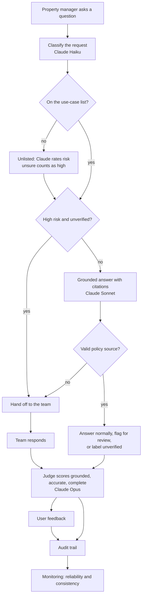

# Glasspine Guide: Today vs. With Safeguards

**Live demo:** https://glasspineguide.vercel.app

Guide is loved and widely used, but behavior varies across accounts, reliability issues are surfacing, and owners and operators want to audit what it produces. Scale here means depth: teams trusting Guide with higher-stakes work. This prototype is Phase 0 of the plan, and shows the same Guide today and with two added safeguards:

- **Trust:** answers grounded in the account's policies, accurate and complete, with risky ones flagged or handed to a person.
- **Dependability:** quality monitored over time against a bar.

## Key decisions and tradeoffs

1. **Depth over breadth.** Fix reliability in existing use cases before adding new ones. *Tradeoff:* no new services in this phase.
2. **Trust before infrastructure.** Grounding, routing, scoring and audit come first. *Tradeoff:* the prototype isn't built for high volume yet; that's Phase 2.
3. **Label, don't block.** Unverified use cases still get answers, labeled as unverified. *Tradeoff:* some unproven answers reach users, but experimentation continues.
4. **Configuration decides risk, not the model.** Each use case's risk tier and verification status set its path. *Tradeoff:* predictability over flexibility; every new use case must be classified.
5. **Unsure means high risk.** Claude rates unlisted requests, defaulting to high. *Tradeoff:* more handoffs, because the model's risk judgment isn't proven either.
6. **Score by the weakest dimension.** Each answer's score is the lowest of grounded, accurate and complete. *Tradeoff:* harsher scores, but no weakness hides behind strengths.
7. **A stronger model judges.** Opus checks Sonnet's answers. *Tradeoff:* slower and costlier per answer; production would add a judge from another vendor, calibrated against human review.

## How an answer flows with safeguards



Today's Guide makes one Claude Sonnet call with the same policies and none of these safeguards.

## Three tabs

**Guide.** Pick a question from the 2×2 decision matrix (risk by verification) or type your own, as Today's Guide or with safeguards.

| | Verified | Unverified |
| --- | --- | --- |
| **Low risk** | Answers normally | Answers, labeled unverified |
| **High risk** | Answers with citations, flagged for review | Hands off to the team |

Every answer with safeguards shows a one-line explanation of its path with a mini grid, cited sources, a judge score (grounded, accurate, complete; the answer score is the lowest), any policy gap the judge traced to the policy rather than the answer, and thumbs up or down. Handoffs take a simulated team response, which is scored the same way or marked "No policy coverage." Every answer lands in the audit trail. Today's Guide uses the same policies and model with none of the safeguards.

**Monitoring (dependability).** For each use case: reliability against its bar, consistency, user feedback with judge disagreements, answer counts, policy gaps, no-coverage count and health. Click a row to see its questions and answers, newest first or lowest score first. Numbers start from a mocked 30-day history and move with live answers.

**Roadmap.** Where Guide stands today, the approach and its four dimensions (trust, dependability, infrastructure, economics), four phases (show the safeguards work; make them complete and dependable; handle many more users; support longer conversations), key decisions and tradeoffs, what's intentionally not done yet, and an enterprise readiness checklist marked Built, Partial or Later.

## The policy gap in the demo

The late-fee question scores below its bar because of a genuine ambiguity in the mock policy: MR-1 says $10 a day applies "from the 6th" without saying whether rent paid on the 7th incurs one day or two. The judge attributes the low score to the policy, and the one answer visibly pulls the policy lookups aggregate down while it stays above its bar. The fix is to clarify the policy, not to change the model.

## Use cases

The scenario's four tasks (policy lookups, drafting resident notices, generating compliance summaries, walking residents through lease changes and qualifying events) plus two invented emerging ones (resident FAQ copy, security deposit deduction letters). Unlisted requests get a risk rating from Claude; if unsure, high.

## Models

| Step | Model |
| --- | --- |
| Classify, and rate risk for unlisted requests | Claude Haiku 5.5 |
| Grounded answer, with safeguards and in Today's Guide | Claude Sonnet 5.5 |
| Judge | Claude Opus 5.5 |

Override with `CLASSIFY_MODEL`, `ANSWER_MODEL` and `JUDGE_MODEL`.

## Real, mocked, assumed, simulated

- **Live AI:** classification and risk rating, answers in both modes, judge scores.
- **Mock:** the account, policy library, use-case list and statuses, seeded score and feedback history, example historical answers for compliance summaries (`lib/data.js`).
- **Assumed:** risk tiers, the verification bar, score bars (90% low, 95% high, set by calibrating against observed scores), high-risk criteria for unlisted requests, 30 scored answers needed before an unverified use case becomes a candidate for verification, matrix categories.
- **Simulated:** Today's Guide mode, and team responses on handoffs.
- **Invented:** the two emerging use cases.

All data is invented and represents no real property, program rule or law.

## Run locally

Prerequisites: Node.js 20 or later, and your own Anthropic API key from console.anthropic.com. You don’t need either to try the prototype; the live demo link above works as is.

```bash
npm install
cp .env.example .env.local   # then add your Anthropic API key
npm run dev                  # open http://localhost:3000
```

## Deploy to Vercel

1. Push this repo to GitHub and import it in Vercel.
2. Add `ANTHROPIC_API_KEY` in project settings.
3. Deploy. The key stays server-side in `app/api/guide/route.js`.
4. Set a monthly spend limit in the Anthropic console, since anyone with the link can trigger model calls.

## Code map

- `app/page.js`: app shell, tabs and session state
- `app/_components/GuideTab.js`: matrix, Today vs. With Safeguards toggle, answer card, team response, audit trail
- `app/_components/MonitoringTab.js`: metrics and drill-down
- `app/_components/RoadmapTab.js`: where Guide stands today, approach, phases, key decisions and tradeoffs, intentionally not doing yet, enterprise readiness checklist
- `app/_components/ui.js`: shared pieces (path explanation, mini grid, score bar, feedback)
- `app/api/guide/route.js`: server route holding the API key; modes `before` (Today's Guide), `after` (with safeguards) and `judge`
- `lib/guide.js`: today's Guide call, the safeguards pipeline, judge
- `lib/data.js`, `lib/roadmap.js`: mocked data and roadmap content
